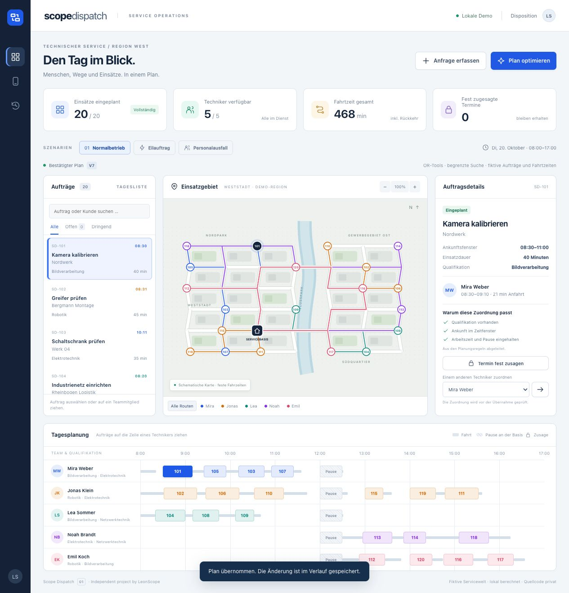
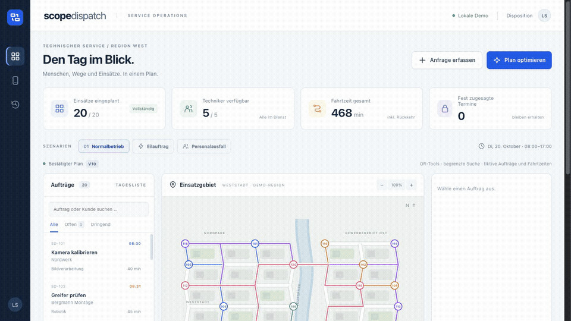
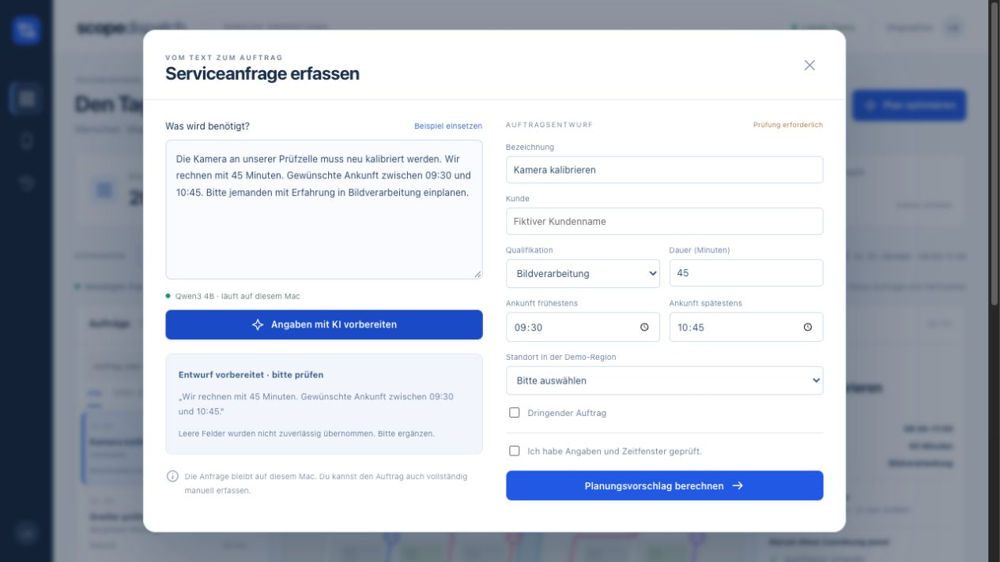

# Scope Dispatch

**English** · [Deutsch](README.de.md)

### Five technicians. Twenty jobs. Then the plan changes.

Scope Dispatch is a local planning application for a fictional technical service team. It matches jobs to qualified people, checks arrival windows and travel times, and lets a dispatcher review changes before accepting them.

I developed it with Codex to explore a different part of industrial software: organizing the people who maintain cameras, robots and production equipment.

## Follow a change through the plan

A camera inspection system needs urgent attention. Scope Dispatch adds the job, calculates a new schedule and shows which appointments would change. A fixed appointment keeps its technician and arrival time. When a team member is absent, the remaining work can be redistributed.

[Watch the screen recording](assets/dispatch-walkthrough.mp4) · [Planning decisions and implementation](docs/CASE_STUDY.md)

The map and timeline use the same calculated plan. Routes follow a fictional road network with fixed travel times. They are not live navigation or traffic data.

## What you can do

- **Plan a service day.** Five technicians, four skill areas, arrival windows, job durations and a shared lunch break at the service base.
- **Review changes.** Every proposal shows its effects before it is saved. Unassigned work remains visible.
- **Protect commitments.** Lock an appointment to its technician and exact arrival time.
- **Reassign a job.** Drag it onto another technician's row, or use the selector. The application checks qualifications and availability before proposing new times.
- **Prepare a request with local AI.** A language model extracts a draft from a service message. Missing or unsupported fields remain empty. A person reviews the details and chooses the customer and location.
- **Keep the confirmed plan accessible.** A compact technician view, a change history and a local export all use the accepted state.

## What I checked

The recorded normal-day comparison scheduled all 20 jobs with both methods. Total travel was **640 minutes** with arrival-order insertion and **468 minutes** with the bounded search. In the combined urgent-job and absence scenario, the search scheduled **21 of 21 jobs**, compared with **19 of 21** for the baseline.

These are measurements from the fictional dataset. They are not customer savings or a claim that the schedule is globally optimal. Search results can vary with available processing time.

**36 automated tests passed.** Six local-model examples also matched all 24 expected structured fields after validation. That small regression set does not establish general language-model accuracy. The [verification notes](docs/VERIFICATION.md) include the comparison table, browser checks, model mistakes found during development and remaining limitations.

## Presentation only

This repository contains documentation and recordings. **Application source, executable files, configuration, database, model files and raw test artifacts remain private.** There is no publicly hosted application.

Original work is not offered under an open-source or Creative Commons license. [Rights](RIGHTS.md) · [Third-party software](THIRD_PARTY_NOTICES.md).

Independent project by **LeonScope**, developed with Codex.
