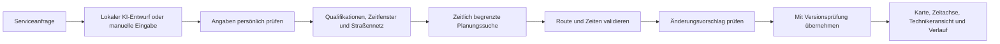

# Warum ich Scope Dispatch gebaut habe

[English](CASE_STUDY.md)

Mein Portfolio enthält bereits ein CRM, Dokumentensuche, Bildprüfung und eine Roboterzellen-Simulation. Bei diesem Projekt wollte ich Planungsentscheidungen sichtbar machen: Wer kann die Arbeit übernehmen, ist die Ankunft rechtzeitig möglich und was verändert ein zusätzlicher Auftrag?

Die Servicefälle betreffen fiktive Kamerasysteme, Roboter und Fertigungsanlagen. Zeichnungen von Arbeitgebern, Kundendaten und echte Betriebsdaten sind nicht enthalten.

## Von der Anfrage zum übernommenen Termin

Die KI bereitet Eingaben vor. Die Zuordnung und Fahrtplanung übernimmt ein lokales Optimierungsverfahren. Vor dem Speichern prüft eine getrennte Validierung, ob der berechnete Plan seine Regeln tatsächlich einhält.

## Wann ein Plan gültig ist

Jeder Auftrag benötigt eine Qualifikation. Die zugeordnete Person muss verfügbar und geeignet sein, im gewünschten Zeitfenster ankommen, die Arbeit vor der nächsten Fahrt beenden, die feste Pause einhalten und vor Schichtende zur Basis zurückkehren.

Bei einem zugesagten Termin bleiben Fachkraft und genaue Ankunft erhalten. Fällt eine Person mit einer solchen Zusage aus, zeigt die Anwendung einen Konflikt. Sie hebt den Termin nicht selbstständig auf.

Die Suche priorisiert dringende Aufträge und anschließend die Zahl der eingeplanten Einsätze gegenüber kleinen Vorteilen bei der Fahrtzeit. Nicht eingeplante Arbeit bleibt sichtbar. Ein offener Auftrag nach Ablauf der Suchzeit beweist allerdings nicht, dass es überhaupt keine passende Lösung gibt.

## Die Oberfläche unterstützt die Entscheidung

Auftragsliste, Karte und Zeitachse sind verbunden. Bei Auswahl eines Auftrags erscheinen seine Anforderungen und die geprüften Bedingungen. Die Farbe einer Fachkraft bleibt in Karte und Tagesplanung gleich.

Wird ein Auftrag auf eine andere Technikerzeile gezogen, legt das die gewünschte Person fest. Die genaue Position beim Ablegen bestimmt keine Uhrzeit. Die Anwendung berechnet passende Ankunftszeiten für den neuen Vorschlag.

Vorschläge bleiben vom bestätigten Plan getrennt. Bei der Übernahme prüft die Datenbank dessen Version. Ein älterer Vorschlag kann deshalb keine inzwischen gespeicherte Änderung überschreiben. In der Technikeransicht erscheint die Neuplanung erst nach der Übernahme.

## Warum die Karte fiktiv ist

Ein kleines Straßennetz macht die Berechnung nachvollziehbar. Die eingezeichneten Wege sind tatsächlich berechnete kürzeste Pfade in diesem Netz. Dieselben Fahrtzeiten verwendet auch die Planung. Die Demo benötigt keinen kostenpflichtigen Karten- oder Routendienst.

Die Grenze ist klar: Die Karte bildet keine echten Straßen, Verkehrslagen, Parkzeiten oder Fahrtdauern ab. Auch der Tag wird als Ganzes geplant; bereits abgeschlossene Einsätze und aktuelle Fahrzeugpositionen werden nicht automatisch berücksichtigt.

## Lokale KI mit persönlicher Prüfung

Im Anfrageformular arbeitet Qwen3 4B auf dem lokalen Mac. Das Modell bereitet Bezeichnung, Qualifikation, Dauer und Ankunftsfenster vor. Kunde und Standort werden von der Person am Formular gewählt.

Während der Entwicklung ließ das Modell einmal eine ausdrücklich genannte Ankunftszeit aus. Bei einer unspezifischen Anfrage zur Fertigung ergänzte es außerdem „Robotik“. Ich habe daraufhin die Feldbeschreibungen präzisiert und zusätzliche Prüfungen eingebaut. Nicht belegte Angaben werden geleert; die persönliche Prüfung bleibt erforderlich.

Die sechs dokumentierten Beispiele prüfen vollständige und unvollständige Anfragen. Sie sind Prüfbeispiele aus der Entwicklung und kein umfassender Genauigkeitsnachweis.

## Meine Rolle und die Umsetzung

Ich habe die Produktrichtung, den industriellen Servicekontext und die Ziele für die Präsentation festgelegt. Die Anwendung habe ich mit Codex entwickelt, einschließlich Planungsablauf, Oberfläche, lokaler Modellanbindung und Tests.

Die private Anwendung verwendet Python, OR-Tools, SQLite sowie JavaScript, HTML und CSS im Browser. Das öffentliche Repository enthält ausschließlich die Fallstudie, Bilder und Aufnahme.
