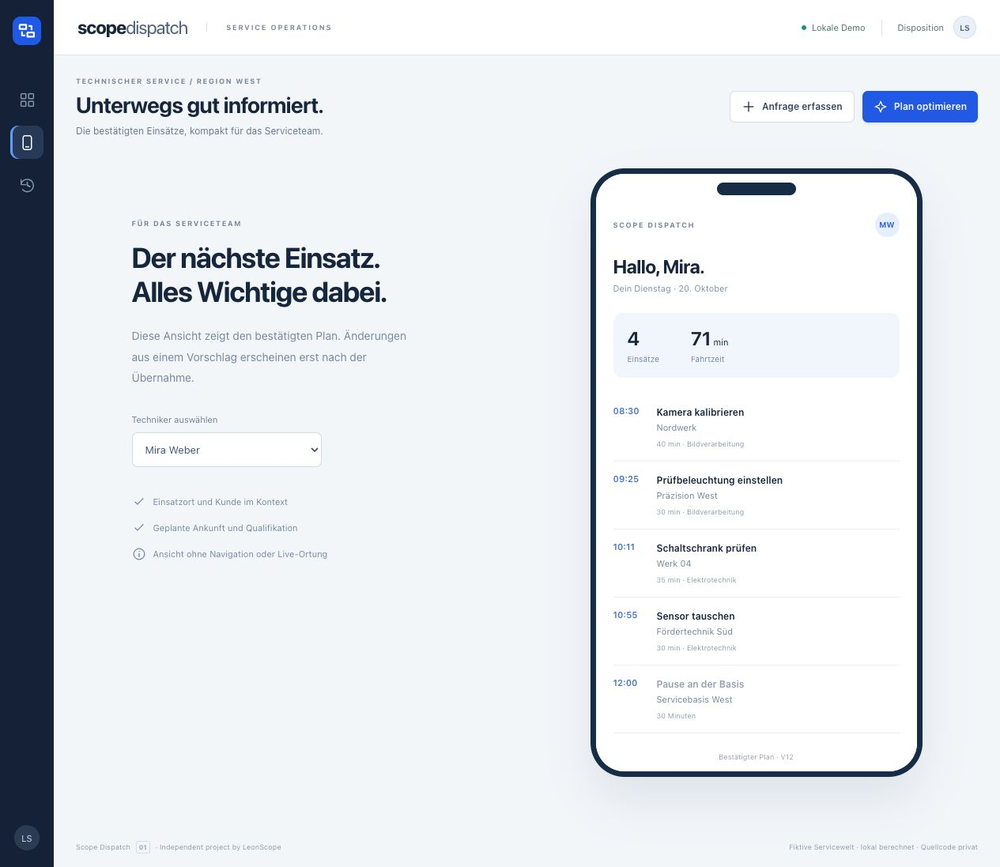

# Why I built Scope Dispatch

[Deutsch](CASE_STUDY.de.md)

My portfolio already includes a CRM, document search, visual inspection and a robot-cell simulation. For this project I wanted to make scheduling decisions visible: who can do the work, whether they can get there in time, and what happens when the plan changes.

The service requests concern fictional cameras, robots and production equipment. No employer drawings, customer records or operating data are used.

## From request to accepted appointment

```mermaid
flowchart LR
    A[Service request] --> B[Local AI draft or manual entry]
    B --> C[Person checks fields]
    C --> D[Skills, time windows and road network]
    D --> E[Bounded scheduling search]
    E --> F[Validate route and timing]
    F --> G[Review proposed changes]
    G --> H[Accept with version check]
    H --> I[Map, timeline, technician view and history]
```

The AI prepares input. It does not decide the route. A local constraint solver assigns jobs and timing. A separate acceptance check rejects inconsistent schedules before they can be saved.

## What makes a schedule valid

Each job needs one skill. The assigned technician must be available and qualified, arrive within the requested window, finish the work before the next journey, attend the fixed break and return to base before the end of the shift.

When a dispatcher locks an appointment, both its person and arrival time are preserved. An absent technician with a locked appointment causes a visible conflict; the application does not silently remove the commitment.

The solver favors urgent work and then job coverage over small travel savings. Some work may remain unassigned when the constraints cannot be met. A job left open after a bounded search is not automatically proof that no feasible schedule exists.

## The interface follows the decision

The job list, map and timeline are linked. Selecting a job opens its requirements and the checks supporting its assignment. Route colors follow the technician throughout the interface.

Dragging a job onto a different technician constrains who should perform it. It does not set an exact arrival time from the drop position. The application proposes times that fit the remaining constraints.

A proposal is separate from the confirmed plan. Accepting it checks the saved version in a database transaction. A second, older proposal cannot overwrite a plan that has since changed. The technician view continues to show the confirmed schedule until the dispatcher accepts the new one.

## Why the map is fictional

A small road graph makes the calculation inspectable. The route lines follow real shortest paths in that graph, and the same edge times feed the scheduler. The demo needs no paid mapping or routing service.

The tradeoff is deliberate: the map says nothing about actual streets, traffic, parking or driving times. The day is also planned as a whole; completed jobs and moving vehicle positions are not tracked.

## Local AI, with review

The request form uses Qwen3 4B on the local Mac. It asks for the job description, skill, duration and arrival window. Customer and location are selected by the person completing the form.

During development, the model omitted one explicitly stated arrival time and inferred “robotics” from an otherwise vague manufacturing request. I refined the field instructions and added conservative validation. Values without support are cleared, and the application still requires review.

The six published check summaries cover ordinary and incomplete requests. They are development regression examples, not a broad benchmark or evidence that arbitrary input will be interpreted correctly.

## My role and the implementation

I chose the product direction, industrial service context and presentation goals. I developed the application with Codex, including the scheduling workflow, interface, local model integration and tests.

The private application uses Python, OR-Tools, SQLite and browser-native JavaScript, HTML and CSS. The public repository contains only the case study, screenshots and recording.
